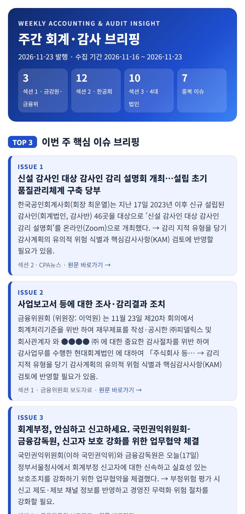
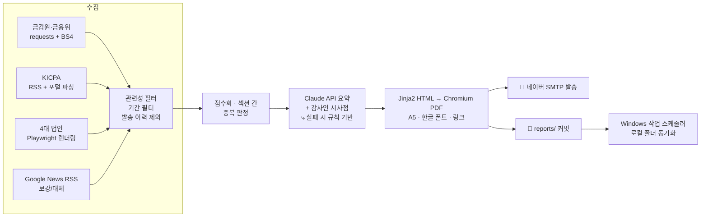

# 📊 주간 회계·감사 인사이트 자동화 파이프라인

> 금융감독원·금융위원회·한국공인회계사회·4대 회계법인의 한 주간 회계·감사 이슈를 자동 수집하고,
> **감사인 관점의 시사점**을 붙여 PDF 브리핑으로 만든 뒤 **매주 월요일 아침 메일로 보내는** 파이프라인입니다.
> PC가 꺼져 있어도 GitHub Actions(클라우드)에서 실행됩니다.


  

<p align="center"></p>

📄 **샘플 리포트:** [docs/sample-report.pdf](docs/sample-report.pdf) · 🗂 **매주 쌓이는 실제 리포트:** [`reports/`](reports/)

---

## 1. 왜 만들었나

감사 실무자는 감독당국의 **감리 조치·규정 개정**, 협회의 **제도 안내**, 대형 법인의 **AI 감사·내부통제 리포트**를 꾸준히 따라가야 하지만,
출처가 7곳 이상으로 흩어져 있고 형식도 제각각입니다. 이 프로젝트는 그 "주간 모니터링"을 자동화해
**월요일 출근길 5분 안에 이번 주 무엇이 바뀌었고 감사인이 무엇을 해야 하는지** 읽을 수 있게 만듭니다.

## 2. 리포트 구성

| 구성 | 내용 |
|---|---|
| **Top 3 핵심 이슈** | 중요도(LLM 평가) + 키워드 가중치 + 다른 출처에서의 반복 보도 수로 선정 |
| **섹션 1** 금감원·금융위 | `회계·감사·감리·외부감사·회계기준·내부회계관리제도` 관련 보도자료 |
| **섹션 2** 한국공인회계사회 | CPA뉴스, 공지사항(협회 주요 활동) |
| **섹션 3** 4대 회계법인 | 삼일PwC·삼정KPMG·안진Deloitte·한영EY 인사이트/뉴스룸 + 언론 보도 |
| **각 항목** | 제목 · 3~4줄 핵심 요약 · **감사인 시사점** · 원문 하이퍼링크 |
| **중복 표시** | "🔁 중복: *섹션 1 · 금융위원회 보도자료*의 「…」과 같은 이슈" 처럼 **어느 섹션의 어느 글**과 겹치는지 표시 |
| **기준 게시물** | 최초 실행 시 최근 30일 주요 게시물을 모니터링 기준점으로 함께 수록 |
| **수집 현황 부록** | 출처별 성공/실패·건수 → 수집 누락을 투명하게 확인 |

## 3. 아키텍처



## 4. 수집 전략 — 사이트마다 다른 장애물

| 출처 | 확인한 문제 | 해결 |
|---|---|---|
| 금융감독원 | 서버 렌더링, 목록/검색 URL마다 파라미터가 달라 같은 글이 중복 수집 | 목록 3페이지 + 키워드 검색을 합친 뒤 `nttId` 로 URL 정규화 |
| 금융위원회 | RSS가 "점검 중"(503) | HTML 목록 + `srchText` 검색 파라미터 사용 |
| KICPA 공지 | 상세 페이지가 포털 프레임(JS) 구조 | 메인 목록의 제목+미리보기 사용, **게시글 번호(`bltnNo`)가 밀리초 타임스탬프**임을 확인해 게시일 복원 |
| KICPA CPA뉴스 | — | 공식 RSS |
| 삼일PwC | `requests` 는 Akamai **403 차단** | Playwright(Chromium)로 렌더링, `pwcReleaseDate` 메타에서 게시일 추출 |
| 삼정KPMG·한영EY | 목록이 JS 렌더링, 메뉴 링크가 다수 섞임 | 법인별 **기사 URL 정규식**으로 본문 링크만 선별, URL 속 날짜로 기간 밖 글을 미리 제외 |
| 안진Deloitte | 보도자료 목록이 HTML에 노출되지 않음 | Google News RSS로 법인명 + 회계·감사·AI 키워드 기사 보강 |
| 공통 | 해외 IP(GitHub 서버) 차단 가능성 | 감독기관 수집 실패 시 **Google News RSS로 자동 대체**, 부록에 실패 사유 기록 |

## 5. 데이터 가공 규칙

- **관련성:** 제목에 핵심 키워드(회계·감사·감리·내부통제·IFRS…) → 채택 / 제목에 AI 키워드 + 본문에 핵심 키워드 → "AI 감사 트렌드"로 채택 / 본문 키워드 다수 → 채택. `감사합니다`, `국정감사` 같은 오탐은 제외어로 제거.
- **중복 판정:** 정규화한 제목의 바이그램 Jaccard ≥ 0.45 또는 SequenceMatcher ≥ 0.62.
  단, `사업보고서 등에 대한 조사·감리결과 조치`처럼 **매 회의마다 같은 제목으로 나오는 정례 보도자료**는 게시일이 3일 넘게 차이 나면 다른 사건으로 봅니다.
  원본은 섹션 번호가 낮고 1차 출처인 글로 정하고, 나머지는 삭제하지 않고 "어디와 중복인지" 표시합니다.
- **요약:** Claude API(`claude-opus-5-5`)가 3~4줄 요약·시사점·중요도(1~10)를 JSON으로 반환. 본문에 없는 사실을 만들지 않도록 프롬프트로 제한.
  API 키가 없거나 호출이 실패하면 **규칙 기반 요약 + 키워드별 시사점 템플릿**으로 자동 전환 → 파이프라인이 멈추지 않음.
- **발송 이력:** `state/seen.json` 에 보낸 URL을 기록해 다음 주에 같은 글이 반복되지 않게 함.

## 6. 자동화 설계 — "노트북이 꺼져 있어도"

| 구성 | 역할 |
|---|---|
| **GitHub Actions** (`.github/workflows/weekly-briefing.yml`) | 매주 일 22:30 UTC = **월 07:30 KST** 실행 → 수집·요약·PDF·메일 발송 → `reports/` 에 PDF 커밋 |
| **Windows 작업 스케줄러** (`scripts/register_task.ps1`) | 로그온 시 + 월 08:15 에 `reports/` 의 새 PDF를 `문서\CPA_Weekly_Briefing` 으로 내려받음. 월요일 아침에 PC가 꺼져 있었다면 **켜는 순간 따라잡음** |
| 로컬 단독 모드 (`-Mode Local`) | GitHub 없이 PC에서 직접 실행. 놓친 일정은 부팅 후 즉시 실행, 절전 해제 실행 지원 |

## 7. 빠른 시작

```powershell
git clone https://github.com/ehdnjs719/accounting-audit-weekly-briefing.git
cd accounting-audit-weekly-briefing
powershell -ExecutionPolicy Bypass -File scripts\setup_windows.ps1   # venv · 패키지 · Chromium · .env
.\.venv\Scripts\python.exe main.py --no-email                         # PDF만 생성해 보기
```

GitHub 자동 실행, 네이버 SMTP, 작업 스케줄러 설정은 **[docs/SETUP_GUIDE.md](docs/SETUP_GUIDE.md)** 에 단계별로 정리했습니다.

| 옵션 | 설명 |
|---|---|
| `--no-email` | 메일 발송 생략 |
| `--no-llm` | 규칙 기반 요약만 사용 |
| `--no-state` | 발송 이력을 읽거나 쓰지 않음 (테스트용) |
| `--baseline on/off/auto` | 초기 기준 게시물 포함 여부 |
| `--days N` | 수집 기간 변경 |

## 8. 폴더 구조

```
├── main.py                       # 파이프라인 진입점 (CLI)
├── config.yaml                   # 키워드 · 가중치 · 상한 · 모델 설정
├── briefing/
│   ├── collectors/               # regulators · kicpa · big4 · google_news
│   ├── browser.py                # Playwright 래퍼 (렌더링 · 403 우회 · PDF)
│   ├── processing.py             # 점수화 · 중복 판정 · 발송 이력
│   ├── summarizer.py             # Claude 요약 / 규칙 기반 대체 / Top 3
│   ├── report.py, templates/     # Jinja2 리포트 · 메일 템플릿
│   └── mailer.py                 # SMTP 발송 (PDF 첨부, 한글 파일명)
├── scripts/                      # Windows 설치 · 작업 스케줄러 · 동기화
├── tests/                        # pytest (날짜 복원 · 중복 판정 · 관련성)
├── reports/                      # 매주 생성된 PDF (Actions 가 커밋)
└── .github/workflows/            # 주간 스케줄
```

## 9. 한계와 개선 계획

- 사이트 개편 시 URL 정규식·본문 셀렉터 수정 필요 → 부록의 수집 현황으로 조기 감지
- Deloitte 한국 사이트는 언론 보도로 보강 중 → 공식 검색 API 확인 후 직접 수집 예정
- 첨부 PDF/HWPX(보도자료 원문) 본문 파싱, 이슈 키워드 주간 추이 차트 추가 예정

## 10. 이 프로젝트로 보여주고 싶은 것

- **도메인:** 외부감사·감리·내부회계관리제도·K-IFRS 이슈를 감사인 관점에서 분류하고 시사점으로 연결
- **데이터 수집:** 정적/동적/봇 차단 사이트를 각각 다른 전략으로 안정적으로 수집하고 실패를 기록
- **자동화:** 클라우드 스케줄링 + 로컬 동기화로 "PC가 꺼져 있어도 도는" 운영 구조
- **LLM 활용:** 구조화된 출력, 사실 왜곡 방지 프롬프트, 실패 시 규칙 기반 대체

---
<sub>본 리포트는 공개된 보도자료·게시물을 자동 수집·요약한 참고 자료이며, 각 저작물의 권리는 원저작자에게 있습니다. 원문 링크로 반드시 확인하세요.</sub>
